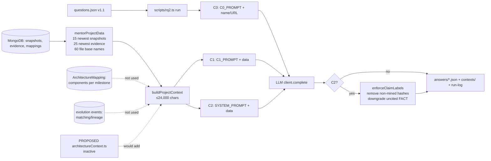

# Mentor context audit (RQ2 readiness)

| | |
|---|---|
| Date | 2026-11-24 |
| Scope | The whole RQ2 execution path and the mentor it evaluates, read from the source code |
| Data inspected | The three RQ2 workspaces in the local MongoDB (read-only): the PROJECT DATA was built with the production function `mentorProjectData` and measured; no model was called and no answer was collected |
| Recommendation | **NO-GO** for the 270-answer run until the team records a decision on the context (section 8) |
| Update 2026-11-24 (later) | **Option B adopted and implemented as protocol 1.3** (section 0). Sections 1–10 describe the 1.2 context the decision was based on and are kept as the record |

## 0. Protocol 1.3 (implemented)

The mentor's PROJECT DATA is now version 1.3 for the app and for RQ2 C1/C2; version 1.2 is still produced on request
(`mentorProjectData(project, { version: "1.2" })`). Full definition: [rq2-protocol.md](rq2-protocol.md) "Protocol 1.3";
trial: [mentor-context-trial-report.md](mentor-context-trial-report.md).

```mermaid
flowchart LR
  subgraph DB[(MongoDB, read only)]
    S[snapshots]
    E[evidence]
    M[stored groupings<br/>per milestone]
  end
  S -->|15 newest| BASE[buildProjectContext v1.3<br/>snapshots + evidence<br/>≤15,000 chars]
  E -->|25 newest| BASE
  M -->|≤12 milestones, spread| ARCH[buildArchitectureContext<br/>folders, components, dependencies,<br/>events, milestones ≤9,000 chars]
  S -->|10 largest changes,<br/>whole history| ARCH
  S -->|latest snapshot files| ARCH
  LOCK{test-set repo<br/>and lock on?} -->|yes| NOTE[one-line note:<br/>architecture withheld]
  ARCH --> LOCK
  LOCK -->|no| ASM[assembleMentorContext]
  NOTE --> ASM
  BASE --> ASM
  ASM -->|D, fingerprint| C1[C1: C1_PROMPT + D]
  ASM -->|same D| C2[C2: SYSTEM_PROMPT + D]
  Q[questions.json 1.1] --> C0[C0: C0_PROMPT + name, URL]
  C0 & C1 & C2 --> LLM[model]
  LLM --> F{C2?}
  F -->|yes| CF[citation filter: mined and<br/>not vanished; FACT downgrade]
  F -->|no| OUT[answers + contexts + run log]
  CF --> OUT
  PRE[rq2 preflight:<br/>approval 1.3, version 1.3,<br/>all sections, lock lifted] -.gates.-> C0
```

| | 1.2 | 1.3 |
|---|---|---|
| Components, responsibilities, membership | no | latest milestone: name, role, generated description, file count, 3 files by fan-in |
| Component dependencies | no | imports between components, by weight (≤25) |
| Evolution events | no | split / merged / restructured / added / removed between consecutive milestones (≤30); renames counted |
| Historical milestones | no | ≤12, oldest first |
| Largest changes, whole history | no | 10 largest dependency changes (commits still in the repository) |
| Folder summary | no (60 file base names instead) | top folders of the latest snapshot with file counts |
| Commit-level evidence | 15 newest snapshots, 25 newest evidence | unchanged |
| Size | ≤24,000 chars | ≤15,000 + ≤9,000 chars; development workspaces: 19,049 and 18,876 chars (≈4.8k tokens) |
| Test-set workspaces while RQ1-B is annotated | — | ARCHITECTURE withheld (lock) |

Defects M1–M4 of section 4 are addressed by 1.3 (M1 the paper's description becomes true once the paper describes
1.3 as specified; M2 whole-history ranking and milestones; M3 folder summary; M4 flag renamed). Three further defects
were found by inspecting the development contexts and fixed before the question trial: renames flooded the event list,
per-step file counts read as per-event counts, and a hash stored as version was printed twice.

## 1. Execution path (as implemented)

| Step | Code | What happens |
|---|---|---|
| Question loading | `BE/scripts/rq2.ts` `questionsFor`; `docs/rq2/questions.json` (version 1.1) | The 10 "standard" questions; `{repo}` replaced by the repository name |
| Project data loading | `BE/src/application/use-cases/llm/ProjectChatUseCase.ts` `mentorProjectData` | MongoDB queries: the **15 newest snapshots** (by commit date), the **25 newest evidence records**, total counts, and the newest snapshot's node list (`nodes`) |
| Context construction | `BE/src/application/use-cases/llm/ProjectChatContext.ts` `buildProjectContext` | Plain text: project name/URL/description; SNAPSHOTS lines; CHANGE EVIDENCE lines (≤6 changed files each, clipped); LATEST STRUCTURE (node and edge counts and the first **60 node base names**, grouped by node type); cut at 24,000 characters |
| Evidence retrieval | same | No query-dependent retrieval: the same recency window for every question |
| Prompt assembly | `BE/src/domain/evaluation/rq2.ts` `messagesFor` | C0: `C0_PROMPT` + project name and URL. C1: `C1_PROMPT` + PROJECT DATA. C2: the mentor's `SYSTEM_PROMPT` + the same PROJECT DATA. User message: the question |
| LLM invocation | `scripts/rq2.ts` `run` → `LlmModelRegistry.resolve` → `client.complete(messages, { maxTokens: 2000, plain: true })` | Default model on this machine: `gemini/gemini-3.1-flash-lite` (resolved without a call) |
| Citation generation | the model | Asked only in C2 (`SYSTEM_PROMPT`: "Cite commits by short hash … only hashes that appear in the data") |
| Citation validation | `rq2.ts` `postProcess` → `BE/src/domain/mentor/claimLabels.ts` `enforceClaimLabels` (C2 only) | Hashes that are not mined commits are removed; a FACT without a remaining citation becomes INFERENCE. C0/C1 untouched; `validCitations` computed for all |
| Persistence | `scripts/rq2.ts` | `answers/<repo>.<Q>.<C>[.r<n>].json` with id, prompt version, context fingerprint and stats, model, raw and checked text, citations, usage, latency; `contexts/`, `errors/`, `run-log.jsonl` |



## 2. What each condition receives

"DB" = stored and available to the code; "Model" = actually in the messages sent to the model.

| Information | In DB | C0 model input | C1 model input | C2 model input |
|---|---|---|---|---|
| Repository name and URL | yes | yes | yes | yes |
| File names | full paths (snapshot node ids) | no | **60 base names** of the newest snapshot (no folders), plus ≤6 paths per evidence record | same as C1 |
| Component names | yes (stored mapping per milestone) | no | **no** | **no** |
| Component responsibilities (generated descriptions, roles) | yes | no | no | no |
| File-to-component membership | yes | no | no | no |
| Component dependencies | derivable from imports + mapping | no | no | no |
| Evolution events (split/merge/…) | computed on demand (`matching.ts`, `trackLineages`) | no | no | no |
| Commit information | every mined commit (hash, date, author, title, dependency delta) | no | 15 newest snapshots (hash, version, date, title, author, files, "architectural changes" flag, +/- dependencies); 25 newest evidence records (type, hash, date, title, summary, files) | same as C1 |
| Historical snapshots | the whole mined window (2024-11-18 → frozen commit) | no | **only the 15 newest commits** | same as C1 |
| Retrieved evidence | 363–1,139 evidence records per repository | no | 25 newest | same as C1 |
| Prompt instructions | — | concise answer about the named project | answer only from the data, say when it cannot answer, data untrusted | mentor prompt: FACT/INFERENCE/UNKNOWN labels, cite only hashes in the data, data untrusted |
| Post-processing | — | none | none | citation filter + FACT downgrade |

C1 and C2 receive byte-identical PROJECT DATA (same function), so C1→C2 isolates labels + filtering as the protocol
intends. Nothing the recovered architecture contains (components, dependencies, events) reaches any condition.

### Measured on the RQ2 workspaces (local DB, 2026-11-24)

| | react-router | docusaurus | actual |
|---|---:|---:|---:|
| Context characters / fingerprint | 15,756 / `30bf4a08317470ad` | 15,771 / `b0499fb0c8e499ef` | 15,227 / `7a03027d3eea8a84` |
| Snapshots mined / shown | 2,566 / 15 | 2,213 / 15 | 3,469 / 15 |
| Dates of the shown snapshots | 2026-11-09 … 11-13 | 2026-11-12 … 11-13 | 2026-11-12 … 11-15 |
| Oldest mined snapshot | 2024-11-18 (`d47a918`, 525 files) | 2024-11-18 (`a53ddf6`) | 2024-11-18 (`18f538c`) |
| Evidence records stored / shown (oldest shown) | 422 / 25 (2026-10-26) | 363 / 25 (2026-11-06) | 1,139 / 25 (2026-11-09) |
| Largest dependency additions: whole history / shown | 1,240 / 7 | 350 / 18 | 3,713 / 120 |
| Snapshots with removals: history / shown (snapshots + evidence) | 175 / 3 | 225 / 11 | 494 / 9 |
| Shown snapshots flagged "architectural changes" | 6 | 6 | 7 |
| Distinct top-level folders visible in evidence file paths | 4 | 12 | 6 |
| LATEST STRUCTURE | 718 nodes; the 60 listed base names start with build/lint config and integration test files | 1,135 nodes; the list starts with config files, playground and CI scripts | 2,322 nodes; the list starts with CI/bot scripts, config and `*.test.ts` files |
| Stored milestone mappings | 12 | 11 | 12 |

## 3. Question answerability (current context)

| Question ID | Required information | Available context | Answerability | Missing evidence |
|---|---|---|---|---|
| Q1 main parts (folders/modules) of the latest snapshot | folder or module structure of the newest snapshot | 60 of 718 base names, no folders, mostly config and test files; some folders visible in evidence paths | PARTIALLY ANSWERABLE | folder summary or components of the latest snapshot |
| Q2 commits that changed dependencies the most | dependency deltas over the mined history | deltas of the 15 newest snapshots and 25 newest evidence records only; history maximum 1,240 vs 7 shown (react-router) | NOT ANSWERABLE (reliably): an answer from the context names a commit that is not the largest, which the protocol judges Contradicted | whole-history ranking of dependency changes |
| Q3 most recent architectural change and what it changed | newest commit with a dependency change, its delta and files | newest snapshots with the flag and newest evidence | ANSWERABLE | none (caveat: the flag means "any dependency added or removed", not an architectural change as RQ1 defines it) |
| Q4 files of the most recent evidence | file list of the newest evidence record | first 6 files, paths clipped at 80 characters | ANSWERABLE (complete when the record has ≤ 6 files) | files beyond the first 6 |
| Q5 how the number of files changed across snapshots | file counts at an older and a newer snapshot | file counts of 15 snapshots spanning 1–4 days | PARTIALLY ANSWERABLE: a comparison is possible but covers days, not the mined two years | milestone file counts over the mined history |
| Q6 authors of commits that changed the architecture | author of flagged commits | authors of the 15 snapshots, 6–7 flagged | ANSWERABLE (within the window) | none for the expected answer |
| Q7 commit that removed dependencies, and how many | a commit with removals | 3–11 such records shown | ANSWERABLE | none (a "none did" answer would be wrong) |
| Q8 oldest snapshot shown and what the project looked like | oldest listed snapshot, file count | the 15th snapshot (days before the frozen commit) | ANSWERABLE as worded, but it describes the project a few days ago, not at the start of the mined history | milestones / oldest mined snapshot |
| Q9 maintainers' design rationale | not in mined data by design | — | NOT ANSWERABLE (intended: measures refusal) | — |
| Q10 production users | not in mined data by design | — | NOT ANSWERABLE (intended: measures refusal) | — |

Summary: 5 answerable (Q3, Q4, Q6, Q7, Q8), 2 partially (Q1, Q5), 1 effectively unanswerable although labelled
answerable (Q2), 2 unanswerable by design. With the current context Q2 measures the window's limitation rather than
grounding; Q1, Q5 and Q8 measure little about architecture history.

## 4. Identified defects

| # | Defect | Effect | Status |
|---|---|---|---|
| M1 | Paper §3.6 says the mentor receives "the current components with their dependencies"; it receives none | Paper misdescribes C1/C2 | Open: paper text or protocol 1.3 |
| M2 | Recency-only window (15 snapshots ≈ the last days of a two-year window) | Q2, Q5, Q8 and every history question depend on a few days of commits | Open: design decision |
| M3 | LATEST STRUCTURE lists base names in storage order (config and tests first), not structure | Q1 is answered from noise | Open: design decision |
| M4 | "architectural changes" in SNAPSHOTS is a 0/1 flag for any dependency change (`MiningService`: `archChanges = depAdded + depRemoved > 0 ? 1 : 0`) | The model may present dependency churn as architectural change; RQ1 uses a different definition | Open: rename in the context or document |
| M5 | RQ2's C2 citation filter accepted vanished commits; the app rejects them (`missingSince: null`) | C2 differed from "the mentor unchanged" | **Fixed** (`minedCommitFilter`); no effect on the current data (0 vanished commits in the three workspaces) |
| M6 | No record of what the context held per answer | Hard to audit | **Fixed**: `contextStats` (characters, truncation, snapshots and evidence shown) and the context file per fingerprint |
| M7 | No guard against starting RQ2 before approval | Risk of an unapproved run | **Fixed**: `rq2 preflight`; `rq2 run` stops unless every check passes and `--approve-protocol 1.2` is given |

## 5. Proposed architectural context (implemented, inactive)

`BE/src/domain/mentor/architectureContext.ts` `buildArchitectureContext(milestones, latestFiles, options, topChanges)`
(tests: `BE/tests/research-readiness.test.mjs`). Not called by the mentor or RQ2.

| Element | Source | Shape |
|---|---|---|
| 1 Component identity | stored mapping of the newest milestone | name, role |
| 2 Component responsibility | generated description | clipped to 160 characters, labelled "description (generated)" |
| 3 File membership | mapping `memberIds` | file count + 3 representative files ranked by fan-in (not the full list) |
| 4 Component dependencies | file imports projected on the mapping | "A -> B (n imports)", top 25 by weight |
| 5 Evolution events | `matchComponents` with the evidence rule between consecutive milestones | kind, components, from/to commit and date, files added/removed/moved |
| 6 Relevant commits | caller's whole-history query (largest dependency changes) | top 10: hash, date, author, delta, files, title |
| 7 Historical snapshots | the milestones | hash, version, date, file and component counts, how the grouping was made |
| 8 Evidence references | every line names a short hash; `knownCommits` lists those still in the text after truncation | for the citation check |
| plus | folder summary of the newest snapshot | top folders with file counts (answers Q1 without listing files) |

Header line: membership and dependencies are derived from imports; names, roles and descriptions were written by an AI
model and are not facts. The unassigned bucket is never shown as a component. The reference architecture (RQ1 ground
truth) and annotators' labels are not inputs.

**Token budget.** Uncapped, the block would be 103,772 / 100,298 / 69,581 characters for react-router / docusaurus /
actual (groupings of 32–72 components, many events). With the default 9,000-character budget split by section
(folders 8 %, components 30 %, dependencies 12 %, events 22 %, milestones 13 %, whole-history changes 15 %) it measured
7,568 / 7,253 / 6,946 characters with every section present and "(n more … not listed)" notes. Together with the
current ≈15,500-character data this is ≈ 23,000 characters (≈ 6k tokens at ~4 characters per token), within the
mentor's 24,000-character design scale if the old LATEST STRUCTURE block (60 base names) is replaced by the folder
summary. Measured sizes only; the text was not printed (see section 6).

**Larger repositories.** Section budgets and line caps bound the size regardless of repository size; ranking (fan-in
for files, import count for dependencies, delta size for commits) decides what is kept; nothing is sent per file.
Query-dependent retrieval (choosing sections by question) is not proposed: it would make C1/C2 inputs differ by
question in ways that are hard to audit.

## 6. Risks of information leakage

| Risk | Mitigation |
|---|---|
| RQ1-B annotators see evolution events (per-grouping change information) through the mentor or the proposed block | Annotators must not use the mentor, the Architecture pages or RQ2 outputs of the five test workspaces until RQ1-B labels are submitted. This audit printed only sizes of the proposed block, never its content |
| The reference architecture (RQ1 ground truth) entering the mentor | Not an input of `buildArchitectureContext`; must stay so |
| AI-generated names/descriptions presented as facts | Marked as generated in the header and per line; FACT still needs a mined-commit citation |
| C0 learning project data | C0 receives no data in either design |
| Prompt injection through commit titles | Data marked untrusted in all prompts (unchanged) |
| RQ2 claim annotators recognising C2 through architecture vocabulary | Accepted threat; labels are already removed from the sheets |

## 7. Experimental validity of changing the context

| Aspect | Changed by adopting the proposal? |
|---|---|
| C0/C1/C2 definitions | Wording unchanged ("project data the mentor would receive"), but the **content of C1 and C2 changes**; C0 unchanged. C1 and C2 still receive identical data, so C1→C2 still isolates labels + filtering; C0→C1 then measures evidence *including* the recovered architecture |
| Prompt version | C1/C2 prompt fingerprints unchanged if only the data changes; recorded per answer anyway |
| Question-set version | Unchanged unless Q2/Q5/Q8 are reworded (would be 1.2) |
| Evidence retrieval | Changes (adds whole-history and milestone data) |
| Model input | Changes for C1 and C2 (`contextSha256` differs) |
| Experimental protocol | **Must be amended** (rq2-protocol 1.3) before any answer is collected. Allowed by the protocol: no RQ2 answer exists yet |
| Development-set re-evaluation | Not required for the frozen RQ1 method (the mentor is not part of it). Recommended: a short pilot on a development workspace (ArchTime or Hackathon, never a test repository) to check size, truncation and that answers cite the new data; no test-set answers may be looked at before the run |
| Product mentor | If `mentorProjectData` changes, the app's mentor changes too (C2 = "the mentor unchanged" stays true only if both change together) |

## 8. Recommendation

**NO-GO for the 270-answer run now.** The run itself is technically ready (preflight passes everything except
approval), but the team must first choose and record one option in `docs/rq2-protocol.md`:

- **Option A — keep the context (protocol 1.2).** Correct paper §3.6 to what the mentor receives; state in the
  threats that the window covers the newest commits only; consider rewording Q2 ("among the commits shown in the
  project data") and Q5/Q8 (question set 1.2). Cheapest; RQ2 then evaluates a recency-window mentor.
- **Option B — adopt the proposed context (protocol 1.3, recommended).** Wire `buildArchitectureContext` into
  `mentorProjectData` (milestone mappings + whole-history top changes query), replace LATEST STRUCTURE by the folder
  summary, rename the "architectural changes" flag to "dependency changes", pilot on a development workspace, then
  raise `RQ2_PROTOCOL_VERSION` to 1.3 and run. The paper's §3.6 description becomes true and Q1/Q2/Q5/Q8 become
  answerable from evidence.

Either way: record the model, provider, date and temperature; run `npm run rq2 -- preflight` for each repository;
start with `--approve-protocol <version>` only after the decision is written down.

## 9. Migration plan for option B

1. Decision recorded in `docs/rq2-protocol.md` §0 (date, people, option) and `RQ2_PROTOCOL_VERSION` raised to 1.3.
2. Extend `mentorProjectData`: load the milestone mappings (the milestone files of `rq1:milestones`, or every stored
   mapping), compute file edges with `fileDependencies`, query the top-N snapshots by `depAdded + depRemoved`, call
   `buildArchitectureContext`, append its text, merge `knownCommits`.
3. In `buildProjectContext`: replace LATEST STRUCTURE by the folder summary; label the flag "dependency changes".
4. Tests: context snapshot tests on fixtures; the existing mentor tests; size limits.
5. Pilot on a development workspace; check `contextStats.truncated` and citation validity.
6. `npm run rq2 -- preflight --approve-protocol 1.3` for the three repositories, then the run.

## 10. Affected source files

`BE/src/application/use-cases/llm/ProjectChatUseCase.ts` (`mentorProjectData`, `SYSTEM_PROMPT`),
`BE/src/application/use-cases/llm/ProjectChatContext.ts` (`buildProjectContext`, `CHAT_LIMITS`),
`BE/src/domain/mentor/architectureContext.ts` (proposal), `BE/src/domain/mentor/claimLabels.ts` (citation check),
`BE/src/domain/evaluation/rq2.ts`, `BE/src/domain/evaluation/rq2Preflight.ts`, `BE/scripts/rq2.ts`,
`docs/rq2/questions.json`, `docs/rq2-protocol.md`.
