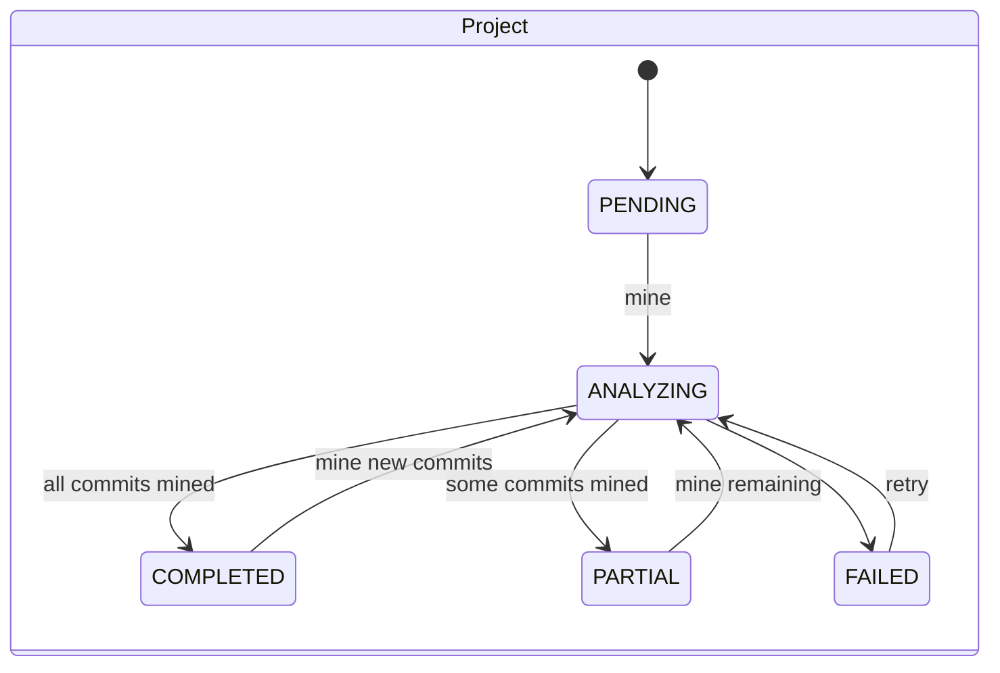
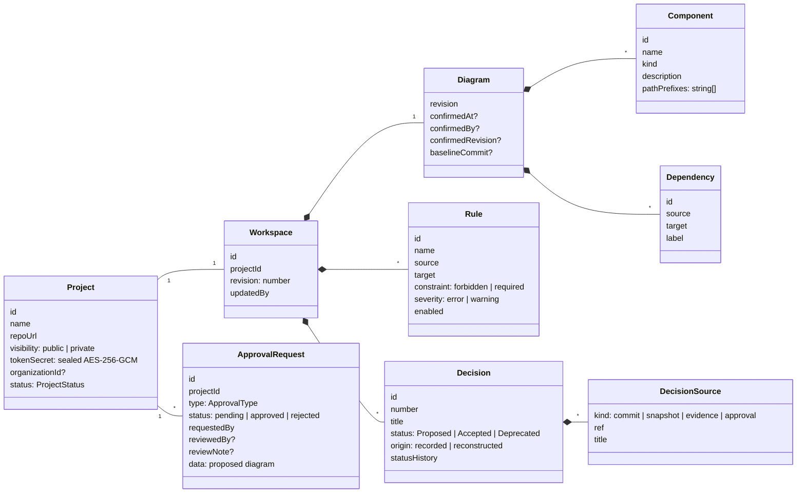
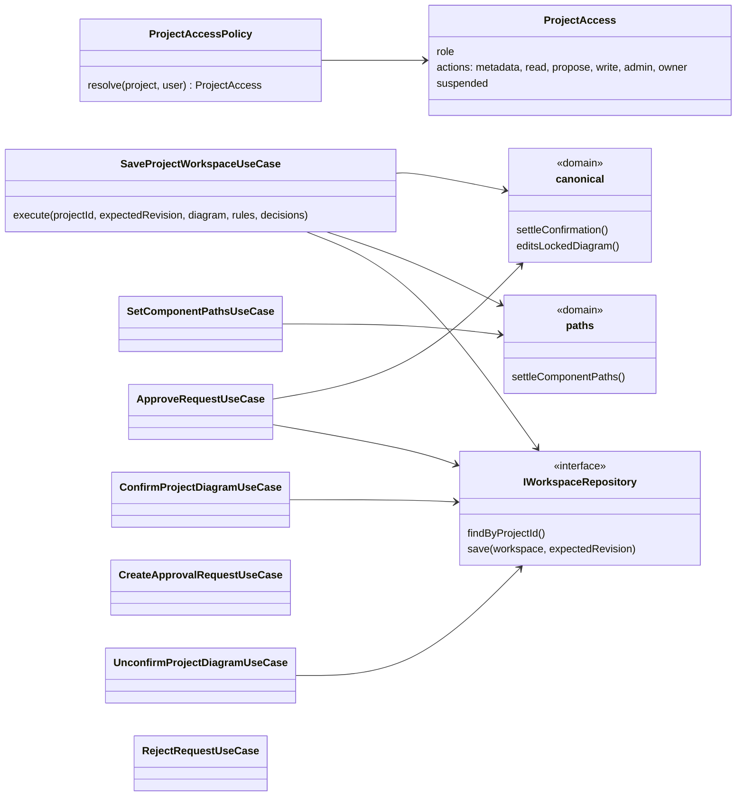
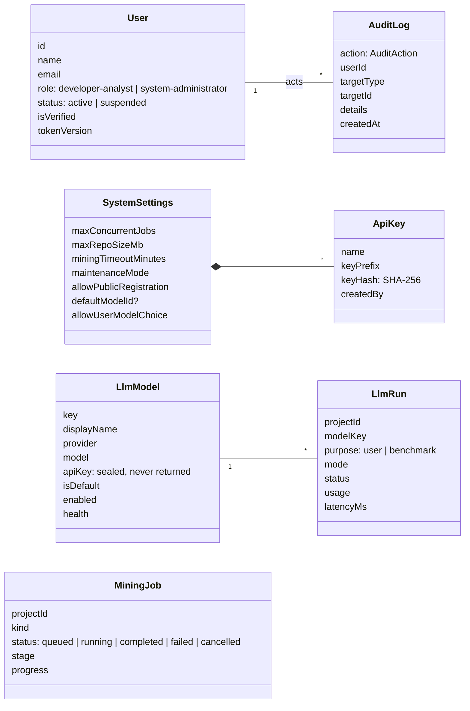
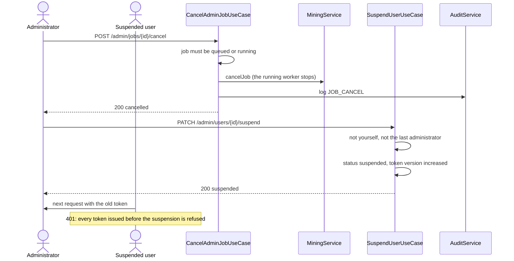
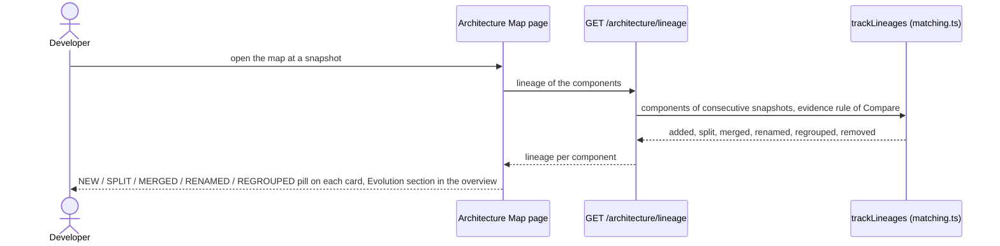

# Report 4: workspace and administration (§3, §4) and SDD §4.1

Content for the parts of Report 4 and the SDD that Bảo owns (BM04 §7.4, tasks B3 and B12), taken from the code on
`Develop` at `b421690`. Copy each part into the matching section of the report; the diagrams are Mermaid, so they
render on GitHub and can be exported as images.

## SDD §4.1: entity states (RF-22, RF-23)

`ProjectStatus.CLONING` and the report statuses that no code wrote are removed. Cloning is now a stage of a mining job,
shown in the job's progress, not a project status. A report is built in the request that asks for it, so it is stored
only when it is ready.

| Entity | States | Where |
| --- | --- | --- |
| Project | `PENDING` → `ANALYZING` → `COMPLETED` / `PARTIAL` / `FAILED` | `domain/entities/Project.ts` |
| Mining job | `queued` → `running` → `completed` / `failed` / `cancelled` (SM-01, SM-02) | `MiningJobModel.ts` |
| Project report | `ready` (the only state) | `domain/entities/ProjectReport.ts` |
| Approval request | `pending` → `approved` / `rejected` (SM-05) | `domain/entities/ApprovalRequest.ts` |
| ADR (decision) | `Proposed` → `Accepted` → `Deprecated`; `Proposed` → `Deprecated` (SM-07) | `domain/entities/Workspace.ts` |
| Project invitation | `pending` → `accepted` / `declined` / `expired` (SM-03) | `domain/entities/ProjectInvitation.ts` |
| Organization membership | `invited` → `active` (SM-04) | `domain/entities/Organization.ts` |
| User | `active` ⇄ `suspended`; an unverified account becomes active on verification (SM-08) | `domain/entities/User.ts` |
| Diagram | draft → confirmed (locked) → draft again on unlock or on any change of content | `domain/architecture/canonical.ts` |



## Report 4 §3: class design, workspace and administration

### Workspace

A workspace belongs to one project and holds its diagram, rules and ADRs. The diagram is the canonical map once it is
confirmed. Every save names the revision it was loaded from, so a stale save is refused (MSG11).





Access is decided once, by `ProjectAccessPolicy`, for every project route. The route names the action it needs; a
caller with no relation to the project gets 404 (N-05), one without the action 403.

| Caller | Actions |
| --- | --- |
| Project owner, organization owner | metadata, read, propose, write, admin, owner |
| Project maintainer | metadata, read, propose, write, admin |
| Project member | metadata, read, propose |
| Viewer of a public personal workspace | metadata, read |
| System Administrator | personal workspace: up to admin; organization workspace: metadata only |
| Anyone else | none → 404 |

### Administration



| Use case | Class | Rule it enforces |
| --- | --- | --- |
| Change a user's role | `UpdateUserRoleUseCase` | the last administrator cannot be demoted (DS-06b) |
| Suspend / reactivate | `SuspendUserUseCase`, `ReactivateUserUseCase` | not yourself, not the last administrator; every session ends |
| Cancel a mining job | `CancelAdminJobUseCase` | only queued or running jobs; audited as `JOB_CANCEL` |
| System settings | `UpdateAdminSettingsUseCase` | positive integers and booleans only, else 400 naming the field |
| API keys | `CreateAdminApiKeyUseCase`, `RevokeAdminApiKeyUseCase` | the key is shown once; only its hash is stored |
| AI models | `AdminLlmUseCases` | exactly one default model; the API key is never returned |

## Report 4 §4: sequence diagrams

### DS-04a: a member proposes a change, a maintainer approves it

```mermaid
sequenceDiagram
    actor M as Member
    actor PM as Maintainer
    participant API as Express route
    participant P as ProjectAccessPolicy
    participant C as CreateApprovalRequestUseCase
    participant A as ApproveRequestUseCase
    participant W as IWorkspaceRepository
    M->>API: POST /projects/{id}/approvals (proposed diagram)
    API->>P: action "propose"
    P-->>API: allowed (member)
    API->>C: execute
    C->>C: check proposed path prefixes (MSG24 on overlap)
    C-->>M: 201 approval pending
    PM->>API: POST /projects/{id}/approvals/{aid}/approve
    API->>P: action "admin"
    P-->>API: allowed (maintainer)
    API->>A: execute
    A->>A: status must be pending, else 400 (MSG12)
    A->>W: findByProjectId
    A->>W: save(proposed diagram, confirmed, baseline = latest commit)
    A-->>PM: 200 approved; the confirmed map moves to the proposal
```

### DS-04b: two tabs save the same workspace

```mermaid
sequenceDiagram
    actor TA as Tab A
    actor TB as Tab B
    participant S as SaveProjectWorkspaceUseCase
    participant W as IWorkspaceRepository
    TA->>S: PUT /workspace (expectedRevision 7)
    S->>W: save(..., 7)
    W-->>S: saved as revision 8
    S-->>TA: 200 revision 8
    TB->>S: PUT /workspace (expectedRevision 7)
    S->>W: save(..., 7)
    W-->>S: conflict: current revision is 8
    S-->>TB: 409 CONFLICT (MSG11); tab A's save is kept
```

### Confirming and locking the diagram (F-07)

```mermaid
sequenceDiagram
    actor PM as Maintainer
    participant S as SaveProjectWorkspaceUseCase
    participant K as canonical
    participant W as IWorkspaceRepository
    PM->>S: PUT /workspace (confirm)
    S->>K: settleConfirmation(request "confirm")
    K-->>S: confirmedAt, confirmedBy, baselineCommit
    S->>W: save
    S-->>PM: 200 confirmed
    PM->>S: PUT /workspace (components changed)
    S->>K: editsLockedDiagram(stored, incoming)
    K-->>S: true
    S-->>PM: 409 DIAGRAM_LOCKED
    Note over PM,S: path prefixes can still be mapped; POST /diagram/unconfirm makes it a draft again
```

### DS-06a: an administrator cancels a job and suspends a user



### Component evolution on the map (RF-18)


