# Hướng dẫn sử dụng: kiểm tra tuân thủ kiến trúc, thông báo và coding agent

Phần hướng dẫn cho Report 6 (User Guide), BM04 §7. Áp dụng cho bản trên nhánh `Develop` từ ngày 15/11/2026.

| Chức năng | Ai dùng | Mục |
|---|---|---|
| Gán đường dẫn (path prefix) cho component | Maintainer | [1](#1-gán-đường-dẫn-cho-component) |
| Kiểm tra tuân thủ kiến trúc (Conformance Findings) | Maintainer; thành viên xem được | [2](#2-kiểm-tra-tuân-thủ-kiến-trúc) |
| Thông báo finding mới (e-mail, trong ứng dụng) | Maintainer, chủ tổ chức | [3](#3-thông-báo-finding-mới) |
| Cho coding agent ngữ cảnh kiến trúc (AGENTS.md, project token) | Maintainer; người dùng coding agent | [4](#4-cho-coding-agent-ngữ-cảnh-kiến-trúc) |
| Chuyển workspace cá nhân vào tổ chức | Chủ workspace | [5](#5-chuyển-workspace-cá-nhân-vào-tổ-chức) |
| Liên kết và gỡ GitHub | Mọi người dùng | [6](#6-liên-kết-và-gỡ-github) |

**Trước khi bắt đầu:** các chức năng 1–4 dựa trên **Component Diagram đã xác nhận** (canonical map). Nếu sơ đồ còn là
*Draft*, vào *Maintain → Component Diagram* và bấm *Confirm diagram* trước.

---

## 1. Gán đường dẫn cho component

Mỗi component của sơ đồ cần biết **file nào thuộc về nó**, qua các *path prefix* (thư mục hoặc file trong repo). Một file
thuộc component có prefix **dài nhất** chứa nó, nên có thể lồng nhau: `BE/src` cho *API*, `BE/src/domain` cho *Domain*.

1. Vào *Maintain → Component Diagram*, chọn workspace.
2. Bấm *Edit* trên một component (hoặc *Add component*).
3. Ở ô **Path prefixes**, gõ đường dẫn rồi nhấn Enter; thêm bao nhiêu cũng được. Viết kiểu nào cũng được
   (`./BE/src/billing/`, `BE\src\billing`): ArchTime tự đưa về `BE/src/billing`.
4. Bấm *Apply changes*, rồi *Save draft* (hoặc *Confirm diagram*).

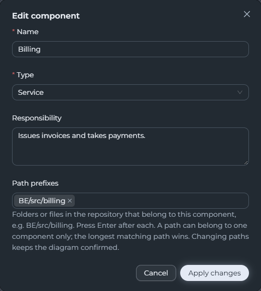

- **Gán path không làm mất xác nhận của sơ đồ**: sơ đồ vẫn là *Canonical map*, chỉ việc ánh xạ file thay đổi.
- Một prefix chỉ thuộc **một** component. Gán trùng sẽ bị từ chối (MSG24):

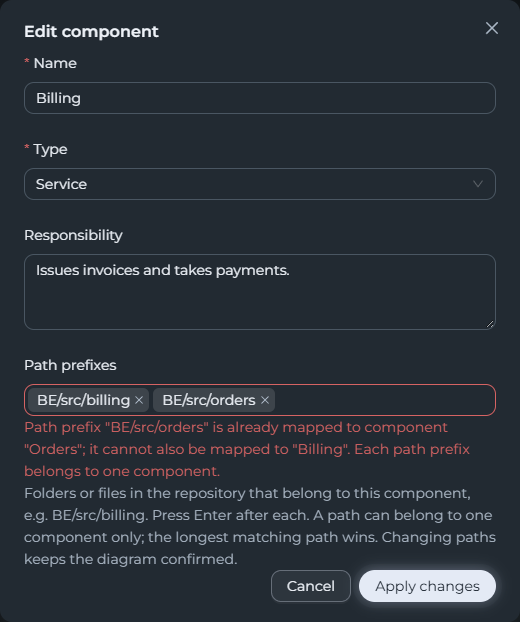

- Danh sách *Components* hiện đường dẫn của từng component; component chưa có đường dẫn hiện *No paths mapped yet* và file
  của nó sẽ không được kiểm tra.

## 2. Kiểm tra tuân thủ kiến trúc

ArchTime so **code của mỗi commit mới** (sau commit baseline, tức commit mới nhất lúc sơ đồ được xác nhận) với sơ đồ đã xác
nhận và các luật ở *Architecture Rules*. Mỗi sai lệch là một **finding**:

| Loại | Nghĩa |
|---|---|
| **Forbidden dependency** | Một luật cấm phụ thuộc A → B, nhưng code có |
| **Missing required dependency** | Một luật bắt buộc A → B, nhưng code không có |
| **Undeclared dependency** | Code có phụ thuộc A → B mà sơ đồ không khai báo |

Check **tự chạy sau mỗi lần fetch hoặc mine** (mục 3). Có thể chạy tay:

1. Vào *Maintain → Conformance Findings*, chọn workspace.
2. Bấm **Run check**. Commit đã kiểm tra với cùng sơ đồ và luật sẽ được bỏ qua; *Check everything again* kiểm tra lại tất cả.
3. Chọn commit ở ô **Commit**, lọc **Open / Decided / All**.
4. Mở **Files to look at** để xem từng import gây ra finding.

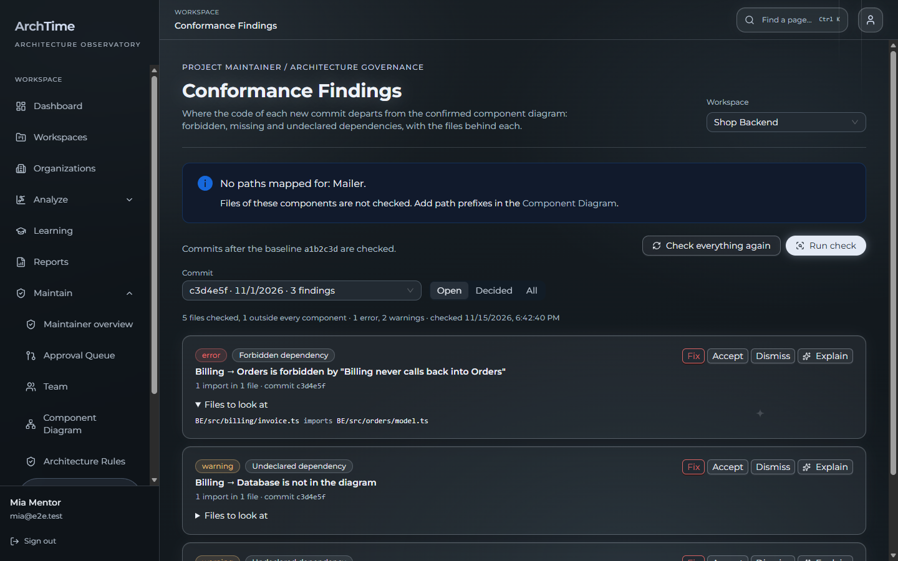

Dòng thông tin dưới ô Commit cho biết số file đã kiểm tra, số file nằm ngoài mọi component, số lỗi và cảnh báo.

### Quyết định về một finding

| Nút | Dùng khi | Ghi chú |
|---|---|---|
| **Fix** | Sai lệch thật, cần sửa code | Không cần lý do |
| **Accept** | Thay đổi có chủ đích; sơ đồ sẽ được cập nhật (qua architecture change request) | Bắt buộc ghi lý do; áp dụng luôn cho finding giống hệt ở các commit sau |
| **Dismiss** | Không phải vấn đề (file sinh tự động, nhận nhầm) | Bắt buộc ghi lý do; áp dụng luôn cho các commit sau |
| **Reopen** | Đổi ý | Đưa finding về *Open* |

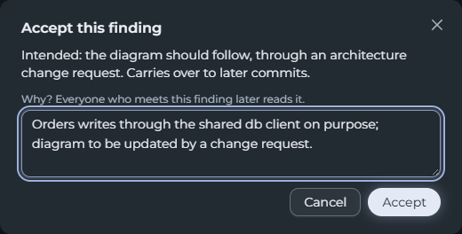

Finding đã quyết định hiện nhãn, người quyết, thời điểm và lý do; finding được áp dụng từ commit trước ghi *carried over from
commit …*:

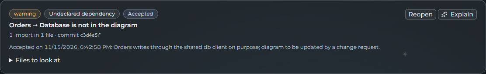

### Giải thích bằng AI

Bấm **Explain** để AI giải thích finding nghĩa là gì, vì sao quan trọng với kiến trúc này, và hai ba cách xử lý (kể cả file cần
sửa). AI chỉ nhận tên, mô tả component, luật, ADR liên quan và đường dẫn file; **không nhận source code**. Câu trả lời được
lưu: lần sau bấm không tốn thêm chi phí AI. Maintainer có thể bấm *Ask again* để hỏi lại.

## 3. Thông báo finding mới

- **E-mail:** sau mỗi lần fetch hoặc mine, nếu có finding mới, **chủ workspace, các maintainer và chủ tổ chức** nhận **một
  e-mail cho mỗi workspace**, liệt kê mỗi vấn đề một lần (tối đa 10 dòng) kèm link tới trang findings. Mỗi finding chỉ được
  gửi e-mail **một lần**. Finding đã được Accept/Dismiss từ trước không được gửi lại.
- **Trong ứng dụng (MSG26):** trang *Maintainer overview* báo số finding mới chưa xem, theo từng workspace; mục *Conformance
  Findings* trên menu có số đỏ tương ứng (hiện cả trên nhóm *Maintain* khi đang thu gọn). Mở trang Conformance Findings của
  workspace là đánh dấu đã xem, **chỉ với người đó**.

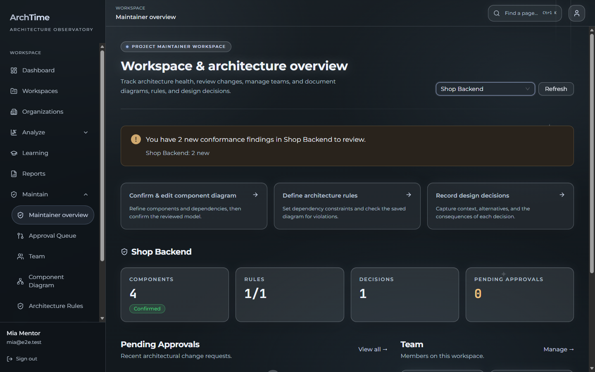

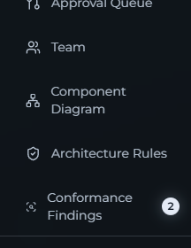

## 4. Cho coding agent ngữ cảnh kiến trúc

Coding agent (Claude Code, Copilot, Cursor…) sửa code nhanh nhưng không biết kiến trúc của dự án. ArchTime cho agent biết,
**trước khi sửa một file**: file thuộc component nào, được phép và không được phụ thuộc vào đâu, ADR liên quan và quy ước
commit. Agent **không bao giờ nhận source code** từ ArchTime.

Vào *Maintain → Agent Access*, chọn workspace.

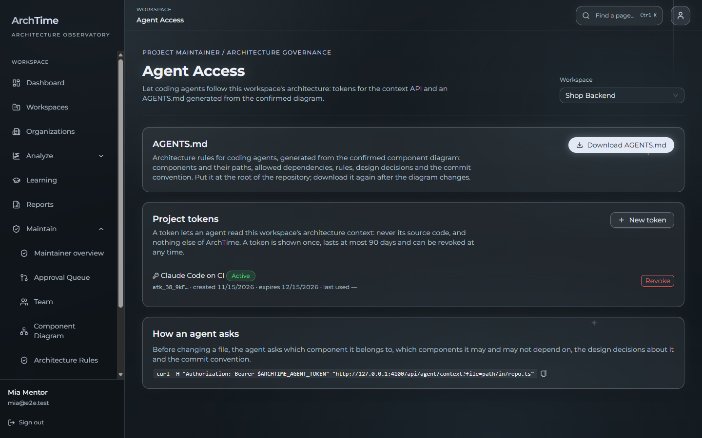

### AGENTS.md

Bấm **Download AGENTS.md** và đặt file ở thư mục gốc repo. File gồm component kèm đường dẫn, phụ thuộc được phép, luật, ADR,
quy ước commit và cách hỏi ArchTime. Tải lại sau khi sơ đồ thay đổi.

### Project token

1. Bấm **New token**, đặt tên theo người hoặc máy dùng nó (ví dụ *Claude Code on CI*), chọn hạn 7–90 ngày.
2. **Sao chép token ngay**: nó chỉ hiện một lần; ArchTime chỉ giữ dấu vân tay của token.
3. Đưa token cho agent qua biến môi trường `ARCHTIME_AGENT_TOKEN`; **không commit token**.

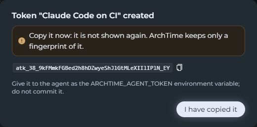

Agent hỏi về một file bằng lệnh ở mục *How an agent asks* trên trang, ví dụ:

```
curl -H "Authorization: Bearer $ARCHTIME_AGENT_TOKEN" "https://<máy chủ ArchTime>/api/agent/context?file=BE/src/billing/invoice.ts"
```

- Token chỉ đọc được ngữ cảnh kiến trúc **của đúng workspace đó**, không mở được chức năng nào khác của ArchTime.
- Mỗi workspace tối đa 10 token đang hoạt động. Danh sách cho biết token tạo khi nào, hết hạn khi nào, dùng lần cuối khi nào.
- Bấm **Revoke** khi không dùng nữa hoặc nghi bị lộ: agent bị từ chối ngay ở lần gọi tiếp theo.

## 5. Chuyển workspace cá nhân vào tổ chức

Chủ một workspace cá nhân có thể chuyển nó vào một tổ chức mà mình là **owner**. Lịch sử commit, evidence, Component Diagram
cùng đường dẫn, luật, ADR và findings đi theo; không có gì bị sao chép hay mất.

1. Vào *Workspaces*, bấm biểu tượng tòa nhà trên thẻ workspace (*Move into an organization*).
2. Chọn tổ chức. ArchTime cho biết trước:
   - tổ chức **đã có workspace cho repo này** chưa (MSG18): nếu có, không chuyển được;
   - **ai sẽ mất quyền xem**: workspace của tổ chức chỉ thành viên tổ chức xem được, nên thành viên workspace không thuộc tổ
     chức sẽ mất quyền (mời họ vào tổ chức để giữ lại).
3. Bấm **Move workspace**.

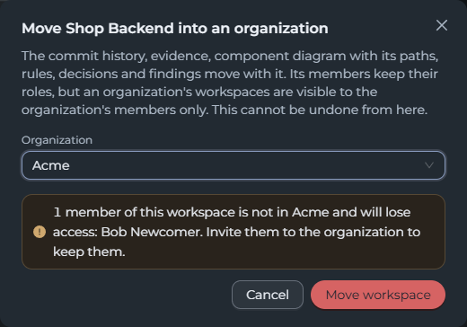

## 6. Liên kết và gỡ GitHub

Vào *My profile* (menu tài khoản góc phải), phần **How you sign in**.

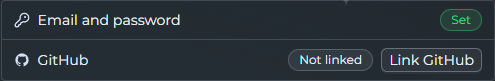

- **Link GitHub:** chuyển sang GitHub để cho phép, rồi quay về Profile với thông báo kết quả. Từ đó đăng nhập được bằng GitHub.
  Không liên kết được nếu tài khoản GitHub đó đã gắn với một tài khoản ArchTime khác.
- **Unlink:** bỏ liên kết. Nếu GitHub là **cách đăng nhập duy nhất** (tài khoản tạo bằng GitHub, chưa có mật khẩu), nút bị
  khoá: đặt mật khẩu ở mục *Set a password* trước, rồi gỡ.

## 7. Thông báo thường gặp

| Thông báo | Nghĩa và cách xử lý |
|---|---|
| *Path prefix "…" is already mapped to component "…"* (MSG24) | Prefix đã thuộc component khác. Bỏ khỏi một trong hai component |
| *Confirm the component diagram before checking conformance* | Sơ đồ chưa xác nhận. Xác nhận ở Component Diagram |
| *The baseline commit … is no longer in the mined history* | Lịch sử repo bị viết lại (force push). Xác nhận lại sơ đồ để đặt baseline mới |
| *No paths mapped for: …* | Các component này chưa có đường dẫn; file của chúng không được kiểm tra |
| *Say why when you accept / dismiss a finding* | Accept và Dismiss cần lý do |
| *You have N new conformance findings …* (MSG26) | Có finding mới chưa xem; bấm tên workspace để mở |
| *The component diagram of this workspace is not confirmed yet* (agent, AGENTS.md) | Agent chỉ đọc được sơ đồ đã xác nhận |
| *This project token was revoked / has expired* | Tạo token mới ở Agent Access |
| *… already has a workspace for this repository* (MSG18) | Tổ chức đã có workspace cho repo này; dùng workspace đó, hoặc xoá một trong hai |
| *GitHub is the only way you sign in* | Đặt mật khẩu trước khi gỡ GitHub |
